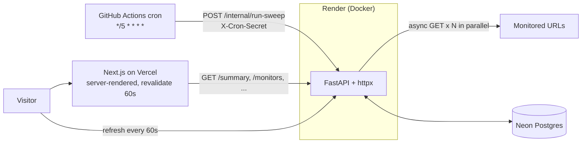

# Cadence

**Uptime, on a steady cadence.**

Cadence watches a handful of URLs, checks them every five minutes, and publishes the results on a dense public status page: uptime, latency percentiles, incidents, and a small game layer (streaks, HP, achievements) computed from real data.

- **Live status page:** https://cadence-status.vercel.app
- **API:** https://cadence-api-ps0o.onrender.com ([interactive docs](https://cadence-api-ps0o.onrender.com/docs))

> The API runs on Render's free tier, which sleeps when idle, so the first request after a pause can take up to a
> minute. The page is server-rendered and cached, so visitors still see the last results while it wakes up.

## Architecture



| Part | Tech |
| --- | --- |
| Backend | Python 3.13+ (3.14 in Docker and CI), FastAPI, httpx, SQLAlchemy 2.0 async + asyncpg, Alembic, Pydantic v2 |
| Database | PostgreSQL (Docker/Podman locally, Neon in production) |
| Frontend | Next.js (App Router), TypeScript, Tailwind, plain SVG charts |
| Scheduler | GitHub Actions cron |
| Hosting | Render (API), Vercel (web) |

A **sweep** checks every monitor in parallel. **Down** = timeout, connection error or 5xx; **slow** = OK but over 500 ms; an **incident** opens after two consecutive failures. The full rules, module map and the reasoning behind each choice are in [`docs/ARCHITECTURE.md`](docs/ARCHITECTURE.md).

## Docs

| Doc | Read it for |
| --- | --- |
| [`docs/ARCHITECTURE.md`](docs/ARCHITECTURE.md) | How it works, the module map, and the decisions and trade-offs |
| [`docs/DEPLOY.md`](docs/DEPLOY.md) | The step-by-step deploy runbook (Neon, Render, Vercel, GitHub secrets) |
| [`docs/BUG_JOURNAL.md`](docs/BUG_JOURNAL.md) | Real bugs hit while building it: symptom, cause, fix, lesson |
| [`docs/INTERVIEW_QA.md`](docs/INTERVIEW_QA.md) | Short answers about the design |
| [`frontend/README.md`](frontend/README.md) | The Next.js app: scripts, data flow, components |

## Run locally

Prerequisites: Python 3.13+ with [uv](https://docs.astral.sh/uv/), Node 22+, and Docker or Podman. No paid keys or API accounts are needed to run it locally.

```bash
# 1. Database (use `podman` instead of `docker` if you prefer)
docker compose up -d db

# 2. Backend
cd backend
cp .env.example .env
uv sync
uv run alembic upgrade head
uv run python -m scripts.seed          # monitors come from seed/monitors.json
uv run uvicorn app.main:app --reload   # http://localhost:8000/docs

# 3. Trigger a sweep (the cron does this in production). Sweeps less than 2 minutes apart
#    are skipped on purpose, so wait between manual runs.
curl -X POST -H "X-Cron-Secret: change-me" localhost:8000/internal/run-sweep

# 4. Frontend
cd ../frontend
cp .env.example .env.local
npm install
npm run dev                             # http://localhost:3000
```

Configuration (all environment variables, see the `.env.example` files):

| Variable | Where | Purpose |
| --- | --- | --- |
| `DATABASE_URL` | backend | Postgres connection string (Neon's plain URL works) |
| `CRON_SECRET` | backend + GitHub secret | Shared secret for `POST /internal/run-sweep`. Required: if unset, sweeps are refused (503) |
| `CORS_ORIGIN` | backend | The only browser origin allowed to call the API |
| `NEXT_PUBLIC_API_URL` | frontend | Base URL of the API |

### Tests and checks

The backend has **114 tests** (`pytest` collects them). They need Postgres running and use a separate `cadence_test` database, created automatically:

```bash
cd backend
uv run pytest                 # tests
uv run ruff check .           # lint
cd ../frontend
npm run lint && npx tsc --noEmit && npm run build
```

CI runs the backend tests and `ruff` on Python 3.13 and 3.14 against a Postgres service, plus the frontend lint, type-check and build.

Regenerate the frontend API types after changing the backend schema (backend must be running):

```bash
cd frontend && npm run gen:types
```

Edit the monitored URLs in `backend/seed/monitors.json`. The seed runs on every deploy and makes the database match the file, matching monitors by `short_code`: new ones are added, changed ones updated, and ones no longer listed are **removed along with their history**. Avoid monitoring services on Render's free tier from the same Render workspace: every 5-minute check keeps them awake and spends the shared free hours (see [`docs/DEPLOY.md`](docs/DEPLOY.md)).

## API

Interactive docs at `/docs`. Try it:

```bash
curl localhost:8000/health
curl localhost:8000/summary                      # KPIs, streaks, next sweep ETA
curl localhost:8000/monitors                     # per-service state, uptime, HP, rank, 30-day history
curl "localhost:8000/monitors/1/latency?range=7d"  # 24h | 7d | 30d
curl "localhost:8000/checks/recent?limit=12"
curl localhost:8000/incidents
curl localhost:8000/achievements
curl -X POST localhost:8000/sweep                # the page's "sweep now" button (public, rate-limited)
curl -X POST -H "X-Cron-Secret: change-me" localhost:8000/internal/run-sweep   # the cron
```

Errors use a uniform `{"detail": "..."}` body: 4xx for bad input, 502/503/504 when the database misbehaves, 401 for a wrong cron secret and 503 if no cron secret is configured.

Both sweep endpoints return `{"sweep_id": N, "skipped": null, "duration_ms": 5600}`, or `{"sweep_id": null, "skipped": "...", "duration_ms": null}` when they deliberately do nothing: another sweep holds the lock, or the previous one started under 2 minutes ago. The yellow countdown tag on the page is a button that calls `POST /sweep`; it needs no secret because those two rules already cap it at one sweep every 2 minutes, whoever presses it.

## Deploy

Short version (full runbook in [`docs/DEPLOY.md`](docs/DEPLOY.md)):

1. **Neon**: create a project and copy the connection string.
2. **Render**: new Blueprint from this repo (`render.yaml`). Set `DATABASE_URL` (Neon string, used as-is), `CRON_SECRET` (`openssl rand -hex 32`) and `CORS_ORIGIN` (your Vercel URL).
3. **Vercel**: import the repo, root directory `frontend`, env var `NEXT_PUBLIC_API_URL` = Render URL.
4. **GitHub**: repo secrets `API_URL` (Render URL) and `CRON_SECRET` (same value as Render). The `Sweep` workflow then runs every 5 minutes. Until both secrets exist it logs a warning and does nothing.

## Limitations

- The free Neon and Render tiers sleep and have storage and compute caps, so the first request after idle is slow.
- **The scheduler is the weak point.** GitHub's cron is best-effort, and on this new, low-activity repo the observed gaps were hours, not 5 minutes (two scheduled runs in about five hours on the first day). The page says so honestly (the countdown shows `DUE` and the last sweep's age) instead of pretending. [`docs/DEPLOY.md`](docs/DEPLOY.md) describes an optional external pinger for steadier timing.
- GitHub disables scheduled workflows in a public repo after 60 days without repository activity. Re-enable **Sweep** in the Actions tab if that happens; GitHub emails the owner first.
- Nothing in the repo authenticates visitors; the dashboard is a public read-only page by design.

## Status

All of the v1 scope is built and deployed: sweeps, incidents, the read API, the game layer, the dashboard with its loading, empty, error and incident states, CI and the cron workflow. A screenshot will be added once the live instance has a day of data.

## Repo layout

```
backend/    FastAPI app, Alembic migrations, seed, tests
frontend/   Next.js app
docs/       architecture, deploy runbook, bug journal, interview Q&A
.github/    CI (backend tests + ruff on Python 3.13/3.14, frontend lint/type-check/build) and the sweep cron
render.yaml docker-compose.yml
```

Built by Bhavanjot Singh.
