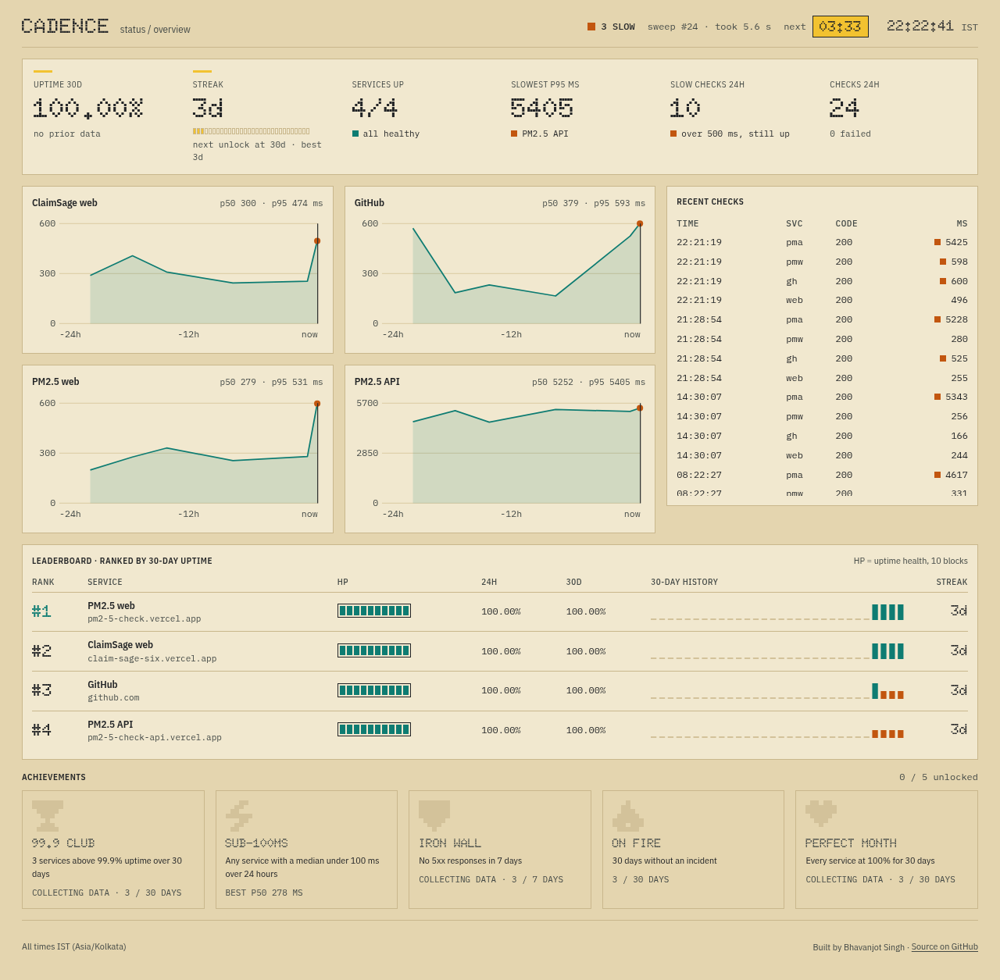
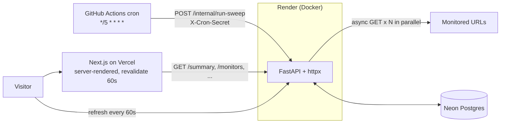

# Cadence

**Uptime, on a steady cadence.**

Cadence watches a handful of URLs, checks them every five minutes, and publishes the results on a dense public status page: uptime, latency percentiles, incidents, and a small game layer (streaks, HP, achievements) computed from real data.

- Live site: _https://cadence.vercel.app (placeholder)_
- API: _https://cadence-api.onrender.com (placeholder)_



## Architecture



| Part | Tech |
| --- | --- |
| Backend | Python 3.14, FastAPI, httpx, SQLAlchemy 2.0 async + asyncpg, Alembic, Pydantic v2 |
| Database | PostgreSQL (Docker/Podman locally, Neon in production) |
| Frontend | Next.js (App Router), TypeScript, Tailwind, plain SVG charts |
| Scheduler | GitHub Actions cron |
| Hosting | Render (API), Vercel (web) |

A **sweep** checks every monitor in parallel (`asyncio.gather`, 10 s timeout). **Down** = timeout, connection error or 5xx. **Slow** = OK but over 500 ms (a warning, still up). An **incident** opens after 2 consecutive failures and resolves on the next success. Uptime, p50/p95 (`percentile_cont`) and daily history are computed in SQL.

## Run locally

Prerequisites: Python 3.13+ with [uv](https://docs.astral.sh/uv/), Node 22+, and Docker or Podman.

```bash
# 1. Database (use `podman` instead of `docker` if you prefer)
docker compose up -d db

# 2. Backend
cd backend
cp .env.example .env
uv sync
uv run alembic upgrade head
uv run python -m scripts.seed          # monitors come from seed/monitors.json
uv run uvicorn app.main:app --reload   # http://localhost:8000/docs

# 3. Trigger a sweep (any time; the cron does this in production)
curl -X POST -H "X-Cron-Secret: change-me" localhost:8000/internal/run-sweep

# 4. Frontend
cd ../frontend
cp .env.example .env.local
npm install
npm run dev                             # http://localhost:3000
```

Tests (need Postgres running; they use a separate `cadence_test` database, created automatically):

```bash
cd backend && uv run pytest
```

Regenerate the frontend API types after changing the backend schema (backend must be running):

```bash
cd frontend && npm run gen:types
```

Edit the monitored URLs in `backend/seed/monitors.json`. The seed runs on every deploy and updates monitors by `short_code`. **Set the real ClaimSage API URL there** (it is a placeholder).

## Deploy

1. **Neon**: create a project and copy the connection string.
2. **Render**: new Blueprint from this repo (`render.yaml`). Set `DATABASE_URL` (Neon string, used as-is), `CRON_SECRET` (`openssl rand -hex 32`) and `CORS_ORIGIN` (your Vercel URL).
3. **Vercel**: import the repo, root directory `frontend`, env var `NEXT_PUBLIC_API_URL` = Render URL.
4. **GitHub**: repo secrets `API_URL` (Render URL) and `CRON_SECRET` (same value as Render). The `Sweep` workflow then runs every 5 minutes.

## Decisions & trade-offs

**Scheduler: GitHub Actions cron.** Free, visible (every run and failure is in the Actions tab), and needs no extra infrastructure. The cost: timing is best-effort (GitHub can start runs minutes late, so "every 5 minutes" is approximate), and Render's free tier sleeps, so the first call after idle waits through a cold start. The workflow uses a 150 s timeout and one retry to absorb that. The alternative, an in-process scheduler, would not survive the service sleeping, which is exactly when you need it.

**The 2-failure rule.** One failed check is often a blip (a dropped packet, a deploy). Requiring two consecutive failures trades up to 5 minutes of detection delay for far fewer false alarms. The incident's start time is backdated to the first failure so durations stay honest.

**5-minute interval.** Frequent enough to catch real outages, sparse enough to stay inside free-tier limits: 4 monitors x 288 sweeps x 30 days is about 35k rows a month.

**Server rendering vs. cold starts.** The page is rendered on the server with `revalidate: 60`, so visitors get cached HTML immediately even while the Render API is waking up. The browser then refreshes every 60 s. If the API is unreachable, the page falls back to a clear error state with a retry button instead of a blank screen.

**No chart library.** The charts are small SVG components (a path, an area, a few gridlines). This keeps the bundle small, avoids a dependency to maintain, and makes every pixel match the design.

**Honest game layer.** Achievements that cover a window (30 days, 7 days) stay locked until the data actually spans that window, so a fresh deployment cannot "unlock" a perfect month on day one. Only unlock timestamps are stored; whether a rule holds is always recomputed from checks.

**Accessibility over exact colours for small text.** The specified teal and orange are about 4.1:1 and 3.7:1 against the panel colour, below the 4.5:1 target for small text. Small status text is therefore charcoal with a coloured square beside it; the exact colours are used for shapes, charts and large type. Lighthouse accessibility: 100.

**Free-tier limits.** Neon and Render free tiers sleep and have storage and compute caps; GitHub cron may be throttled on busy days. For a production service you would move to a paid always-on instance and a real scheduler.

## Repo layout

```
backend/    FastAPI app, Alembic migrations, seed, tests
frontend/   Next.js app
.github/    CI (pytest on Python 3.13 and 3.14) and the sweep cron
render.yaml docker-compose.yml
```

Built by Bhavanjot Singh.
