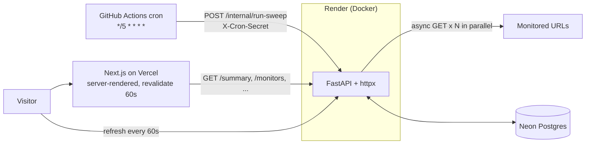

# Cadence architecture

How Cadence works and why it is built this way. For setup see the [README](../README.md); for deploying see
[`DEPLOY.md`](DEPLOY.md).

## The two flows

**Sweep (writes).** A sweep starts in one of three ways, all through the same guarded code path: an open page runs
one when the predicted time has passed, a visitor presses the countdown tag, or the GitHub Actions cron fires (often
hours late). The cron, every five minutes in principle, calls `POST /internal/run-sweep` on the API with the
`X-Cron-Secret` header. The API checks every monitor in parallel, stores each result, and opens or resolves incidents.
Everything else (uptime, percentiles, streaks, HP, achievements) is derived from the stored checks when it is read.

**Page view (reads).** The Next.js page is rendered on the server and cached for 60 seconds, so a visitor gets HTML
immediately even if the API is asleep. In the browser the page then refreshes itself every 60 seconds.

## The sweep rules

- Every monitor is checked with one HTTP GET, all in parallel (`asyncio.gather`), with a 10 second timeout.
- **Down** = timeout, connection error or HTTP 5xx. **Slow** = OK but over 500 ms (a warning; still up).
- An **incident** opens after 2 consecutive failures and resolves on the next success. Its start time is backdated to the
  first failure.
- Uptime, p50/p95 latency (`percentile_cont`) and the daily history are computed in SQL, not in Python.
- Only one sweep runs at a time (a Postgres advisory lock), and a sweep is skipped if the previous one started under
  2 minutes ago. Without that, a retried or overlapping request could record one outage twice and open an incident
  that the 2-failure rule was meant to prevent.
- `POST /internal/run-sweep` refuses to run (503) when `CRON_SECRET` is unset, so a missing setting fails closed.
- When a sweep is due, an open page runs it itself, once per due time and after a random 0.5-3 s delay so several
  tabs do not fire together; whichever loses the race is told "in progress" and just reloads the result.
- The page's countdown tag is also a **sweep now** button (`POST /sweep`). It is public, so it takes no secret; the lock
  and the 2-minute gap are what limit it. Both endpoints share `try_sweep()` in `backend/app/sweep.py`, so the rules
  cannot drift apart. Each sweep's duration (finished minus started) is shown in the header.

## Module map

| Path | Role |
| --- | --- |
| `backend/app/main.py` | FastAPI app, CORS, router wiring |
| `backend/app/config.py` | Settings from the environment; rewrites Neon's connection string for asyncpg |
| `backend/app/db.py`, `models.py` | Async engine and session; tables `Monitor`, `Check`, `Sweep`, `Incident` and the achievements |
| `backend/app/sweep.py` | The sweep: parallel checks, storing results, opening and resolving incidents; `try_sweep()` adds the lock and the 2-minute gap |
| `backend/app/queries.py` | SQL aggregates (uptime, percentiles, daily history) |
| `backend/app/game.py` | Streaks, HP, rank and achievements, computed from real checks |
| `backend/app/routers/read.py` | The public read endpoints |
| `backend/app/routers/internal.py` | `POST /internal/run-sweep` for the cron, guarded by `X-Cron-Secret` |
| `backend/app/routers/sweep_now.py` | `POST /sweep`, the public button; rate-limited by `try_sweep()` |
| `backend/app/clock.py` | The current-time dependency, overridden in tests to pin the clock |
| `backend/app/errors.py`, `schemas.py` | Uniform `{"detail": ...}` errors; Pydantic response models |
| `backend/migrations/`, `scripts/seed.py`, `seed/monitors.json` | Alembic migrations and the monitor seed: on every deploy it makes the table match the file (add, update, remove by `short_code`) |
| `frontend/app/page.tsx` | Server-rendered page (`revalidate = 60`) that loads the first data |
| `frontend/components/` | Dashboard and its sections; see [`frontend/README.md`](../frontend/README.md) |
| `frontend/lib/` | API client, generated API types, formatting, a ticking clock hook |

## Decisions & trade-offs

**Scheduler: GitHub Actions cron.** Free, visible (every run and failure is in the Actions tab), and needs no extra infrastructure. The alternative, an in-process scheduler, would not survive the free service sleeping, which is exactly when you need it. The cost turned out to be larger than expected: on a new, low-activity repo GitHub ran the `*/5` schedule hours apart, not every 5 minutes. Scheduled workflows are also disabled after 60 days without repository activity. The workflow uses a 150 s timeout and one retry to survive Render's cold start, and the API's 2-minute minimum gap stops that retry from counting a failure twice. For steadier timing, an external pinger can call the same endpoint (see [`DEPLOY.md`](DEPLOY.md)).

**Honest time on the page.** Because sweeps can be late, the header's countdown switches to `DUE` once the predicted time passes, and shows the last sweep's age when it is more than 10 minutes old. Each latency chart ends at the moment the data was loaded, so a gap since the last sweep is visible as a gap rather than being stretched to "now".

**The 2-failure rule.** One failed check is often a blip (a dropped packet, a deploy). Requiring two consecutive failures trades up to 5 minutes of detection delay for far fewer false alarms. The incident's start time is backdated to the first failure so durations stay honest.

**5-minute interval.** Frequent enough to catch real outages, sparse enough to stay inside free-tier limits: 4 monitors x 288 sweeps x 30 days is about 35k rows a month.

**Server rendering vs. cold starts.** The page is rendered on the server with `revalidate: 60`, so visitors get cached HTML immediately even while the Render API is waking up. The browser then refreshes every 60 s. If the API is unreachable, the page falls back to a clear error state with a retry button instead of a blank screen.

**No chart library.** The charts are small SVG components (a path, an area, a few gridlines). This keeps the bundle small, avoids a dependency to maintain, and makes every pixel match the design.

**No pooled latency KPIs (a deliberate deviation from the original spec).** The spec's KPI strip had a median and a p95 over all services combined. Pooling GitHub, two Vercel apps and anything with a cold start produces a number that describes none of them (a single cold start showed up as a 5 s "p95"). The strip instead shows the **slowest service's p95** by name and the **number of slow checks** (successful but over 500 ms) in the last 24 hours. Per-service p50/p95 stay on each chart.

**Chart axis (a deliberate deviation from the design).** The design fixes the y-axis at 600 / 300 / 0 ms. The axis keeps that scale normally, but grows in 300 ms steps when a spike goes above 600 ms. Clipping the spike at the top edge would hide exactly the event the orange dot is there to mark.

**Honest game layer.** Achievements that cover a window (30 days, 7 days) stay locked until the data actually spans that window, so a fresh deployment cannot "unlock" a perfect month on day one. Only unlock timestamps are stored; whether a rule holds is always recomputed from checks.

**Accessibility over exact colours for small text.** The specified teal and orange are about 4.1:1 and 3.7:1 against the panel colour, below the 4.5:1 target for small text. Small status text is therefore charcoal with a coloured square beside it; the exact colours are used for shapes, charts and large type. Lighthouse accessibility: 100.

**Free-tier limits.** Neon and Render free tiers sleep and have storage and compute caps; GitHub's cron is best-effort and was observed running hours apart. For a production service you would move to a paid always-on instance and a real scheduler.

**What to monitor on free tiers.** Render gives each workspace 750 free instance hours a month, shared by all its free services, and suspends them all when the hours run out. A free service sleeps after 15 idle minutes, but a check every 5 minutes means it never does: the Cadence API alone uses about 744 hours. So Cadence monitors services hosted elsewhere (Vercel, GitHub). Monitoring another free Render service from the same workspace would double the usage and take both offline around mid-month.

