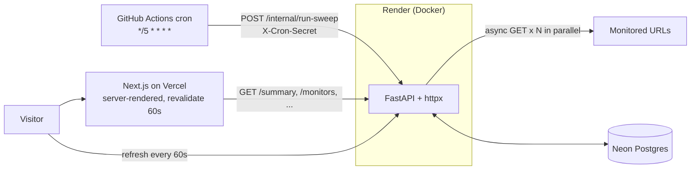

# Cadence architecture

How Cadence works and why it is built this way. For setup see the [README](../README.md); for deploying see
[`DEPLOY.md`](DEPLOY.md).

## The two flows

**Sweep (writes).** Every five minutes a GitHub Actions cron calls `POST /internal/run-sweep` on the API with the
`X-Cron-Secret` header. The API checks every monitor in parallel, stores each result, and opens or resolves incidents.
Everything else (uptime, percentiles, streaks, HP, achievements) is derived from the stored checks when it is read.

**Page view (reads).** The Next.js page is rendered on the server and cached for 60 seconds, so a visitor gets HTML
immediately even if the API is asleep. In the browser the page then refreshes itself every 60 seconds.

## The sweep rules

- Every monitor is checked with one HTTP GET, all in parallel (`asyncio.gather`), with a 10 second timeout.
- **Down** = timeout, connection error or HTTP 5xx. **Slow** = OK but over 500 ms (a warning; still up).
- An **incident** opens after 2 consecutive failures and resolves on the next success. Its start time is backdated to the
  first failure.
- Uptime, p50/p95 latency (`percentile_cont`) and the daily history are computed in SQL, not in Python.

## Module map

| Path | Role |
| --- | --- |
| `backend/app/main.py` | FastAPI app, CORS, router wiring |
| `backend/app/config.py` | Settings from the environment; rewrites Neon's connection string for asyncpg |
| `backend/app/db.py`, `models.py` | Async engine and session; tables `Monitor`, `Check`, `Sweep`, `Incident` and the achievements |
| `backend/app/sweep.py` | The sweep: parallel checks, storing results, opening and resolving incidents |
| `backend/app/queries.py` | SQL aggregates (uptime, percentiles, daily history) |
| `backend/app/game.py` | Streaks, HP, rank and achievements, computed from real checks |
| `backend/app/routers/read.py` | The public read endpoints |
| `backend/app/routers/internal.py` | `POST /internal/run-sweep`, guarded by `X-Cron-Secret` |
| `backend/app/errors.py`, `schemas.py` | Uniform `{"detail": ...}` errors; Pydantic response models |
| `backend/migrations/`, `scripts/seed.py`, `seed/monitors.json` | Alembic migrations and the monitor seed (upserts by `short_code` on every deploy) |
| `frontend/app/page.tsx` | Server-rendered page (`revalidate = 60`) that loads the first data |
| `frontend/components/` | Dashboard and its sections; see [`frontend/README.md`](../frontend/README.md) |
| `frontend/lib/` | API client, generated API types, formatting, a ticking clock hook |

## Decisions & trade-offs

**Scheduler: GitHub Actions cron.** Free, visible (every run and failure is in the Actions tab), and needs no extra infrastructure. The cost: timing is best-effort (GitHub can start runs minutes late, so "every 5 minutes" is approximate), and Render's free tier sleeps, so the first call after idle waits through a cold start. The workflow uses a 150 s timeout and one retry to absorb that. The alternative, an in-process scheduler, would not survive the service sleeping, which is exactly when you need it.

**The 2-failure rule.** One failed check is often a blip (a dropped packet, a deploy). Requiring two consecutive failures trades up to 5 minutes of detection delay for far fewer false alarms. The incident's start time is backdated to the first failure so durations stay honest.

**5-minute interval.** Frequent enough to catch real outages, sparse enough to stay inside free-tier limits: 4 monitors x 288 sweeps x 30 days is about 35k rows a month.

**Server rendering vs. cold starts.** The page is rendered on the server with `revalidate: 60`, so visitors get cached HTML immediately even while the Render API is waking up. The browser then refreshes every 60 s. If the API is unreachable, the page falls back to a clear error state with a retry button instead of a blank screen.

**No chart library.** The charts are small SVG components (a path, an area, a few gridlines). This keeps the bundle small, avoids a dependency to maintain, and makes every pixel match the design.

**Honest game layer.** Achievements that cover a window (30 days, 7 days) stay locked until the data actually spans that window, so a fresh deployment cannot "unlock" a perfect month on day one. Only unlock timestamps are stored; whether a rule holds is always recomputed from checks.

**Accessibility over exact colours for small text.** The specified teal and orange are about 4.1:1 and 3.7:1 against the panel colour, below the 4.5:1 target for small text. Small status text is therefore charcoal with a coloured square beside it; the exact colours are used for shapes, charts and large type. Lighthouse accessibility: 100.

**Free-tier limits.** Neon and Render free tiers sleep and have storage and compute caps; GitHub cron may be throttled on busy days. For a production service you would move to a paid always-on instance and a real scheduler.
